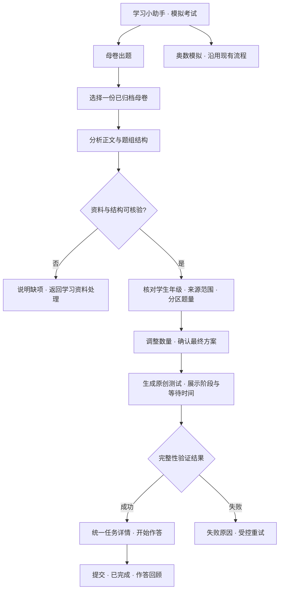

# 母卷原创测试：用户流程

## 1. 背景

Gate 3待确认，2026-10-16。依据[已确认PRD](../plans/2026-10-16-source-paper-practice-prd.md)。本文约束交互，不是已实现功能。

## 2. 目标

从归档试卷发起适合当前学生年级的原创测试，不要求章节；学生在生成前能核对来源范围、题型与题量。对应BR-SP-001～009、US-SP-001～005。

## 3. 方案

### 3.1 入口与流转

全局导航保持“我的看板 → 学习资料 → 学习小助手 → 智慧课堂”。小助手保持三个同级入口：“教材章节学习 / 错题讲解与测验 / 模拟考试”。现有“奥数模拟考试”更名为“模拟考试”，内部以分段选择“母卷出题 / 奥数模拟”切换，不新增第四个入口。默认母卷出题；切换奥数后展示既有奥数表单，不要求章节。

### 3.2 页面与动作

| 视图 | 主要信息 | 主操作与退出 |
| --- | --- | --- |
| 选卷 | 当前学生与目标年级；母卷标题、学科、源卷年级、解析状态和范围说明 | “分析母卷”；空列表引导学习资料。未选择默认不发分析请求。 |
| 分析中 | 母卷标题、“正在分析母卷结构”、已等待时间 | 禁用重复分析；换卷/换学生使旧响应失效，不误接入新视图。 |
| 结构确认 | 来源摘要、知识点、分区/题型、题组数、可作答子题数、目标年级；原题全文不在摘要展开 | 修改数量；“确认并生成原创测试”；可换卷返回。 |
| 生成中 | 已确认总题数、阶段、已等待时间；提示防止重复创建 | 按既有规则锁定至终态或5分钟；超时解锁后可查询原任务。 |
| 成功 | 标题、总题量、已存入智慧课堂；不把生成成功称为学习完成 | “开始作答”；“前往智慧课堂”。 |
| 作答/回顾 | 复用新版任务详情、阅读材料、题目、选项、答案控件 | 提交后标为已完成，按题连续显示学生答案、参考答案、解析；可标记需巩固。 |

### 3.3 表单与确认规则

- 母卷只选一份；候选来自归档资料库中明确为试卷的资料，不含扫描作业库。不以标题猜测替代来源分类。
- “母卷出题”和“奥数模拟”共用页面入口，不共用来源判定或命题规则。切换模式使旧分析和未提交配置失效，切回母卷模式需重新核验；生成锁定期间不可切换模式。
- 目标年级只读显示当前学生档案的有效年级。缺失或仅有系统兜底值时，引导先确认学生档案；不偷偷采用母卷年级。
- 每个分区/题型行显示“母卷题数”和“本次题数”；本次默认为母卷可作答子题数。题组数独立说明，不计入题数。
- 本次题数为正整数；本轮不增加“删除题型”能力。空值、小数、负数、零、非数值均就地提示，不能提交。总题数随合法输入更新；非法输入时总数显示“待修正”。
- 不设置旧版9/10题上限；实际支持边界由Gate 4确定并公开提示。不能在后台截题或在UI自动改数。
- 题组子题总数是用户调整单位；系统负责重新组织完整材料和题组，不要求用户分配每组子题。若在确认前发现该组合无法组织，必须说明具体原因；不得修改总数后继续生成。
- 本次来源范围为“完整试卷”或已核验“仅笔试版”。源卷有残留缺失听力/阅读/图片材料时，阻断并要求回资料页修正范围或补齐资料，不提供静默跳过按钮。
- 年级不同展示“母卷五年级 · 本次按四年级生成”；同知识点可适配才继续，无法适配时列明不适配知识点并阻断。
- 确认区直接列出“当前学生、目标年级、母卷、学科、范围、最终各类题数、总题数、原创说明”，无需再次弹出重复确认框。
- 不新增难度、学期、评分方式等未确认控件。

### 3.4 进度、刷新和后续访问

分析与生成分开。阶段信息以服务端可证实状态为准；无细粒度进度时只显示处理中与真实耗时，不编造百分比。5分钟是页面锁定阈值，不是完成时限。

生成锁定期间，页内导航、学生切换、表单和重复提交不可操作；键盘焦点保持在有明确状态名称的进度区域。浏览器关闭/刷新无法绝对禁止，应能恢复已受理任务状态。网络断开不判定生成失败；收到终态前不给“重新生成”入口。

解锁后显示“已等待5分钟，后台仍可能继续，请查看原任务”；继续禁止同一意图重复提交，允许访问其他页面。若受理结果未知，先核验原请求，不能直接新建任务。

成功任务同时可从智慧课堂“模拟考试”和学习资料“生成的学习资料”进入。沿用学科/完成状态筛选、删除确认、A4试卷和答案卷下载；删除生成资料不删除上传母卷。

### 3.5 原型决策与评审边界

不另做可运行原型：本轮沿用现有页面壳和生成流程，核心交互已由状态及验收约束；后续实现提供390/768/1440截图。结构摘要只呈现必要数据，不显示开发用JSON、模型推理、密钥或内部文件路径。

## 4. 风险

- 缺材料和已核验笔试范围必须区分，否则会再次生成伪完整试卷。
- 选卷分析可能产生模型费用；Gate 4必须区分查询与分析写操作、数据发送提示和请求去重。
- 本页只承诺行为；异步恢复、题型表达和上下限需Gate 4稳定契约，不能仅靠前端计时器实现。
